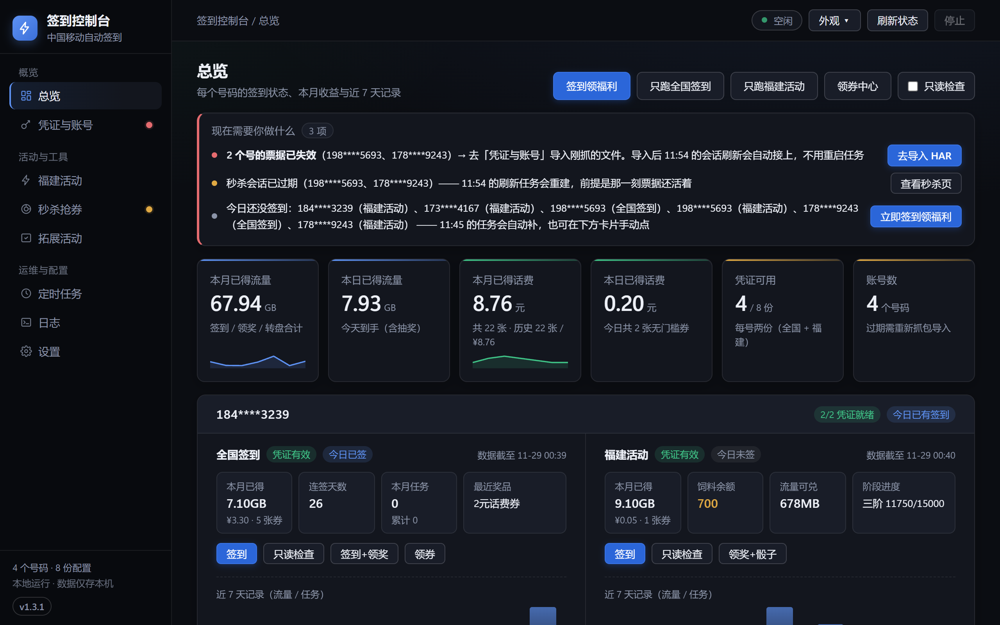
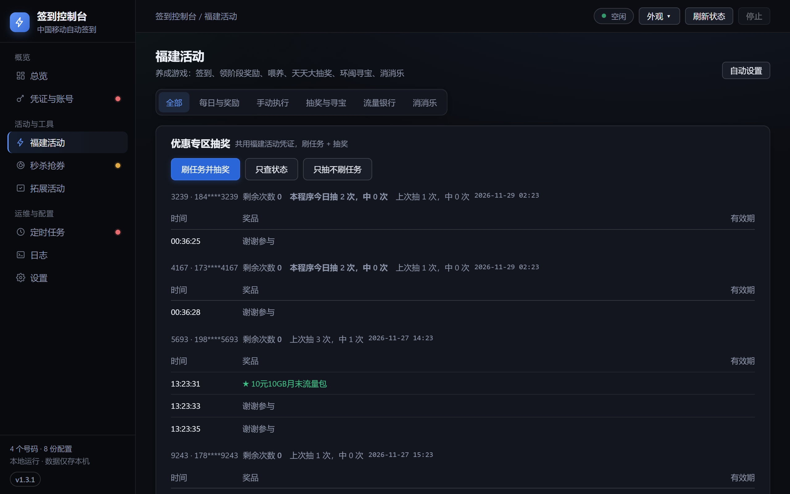
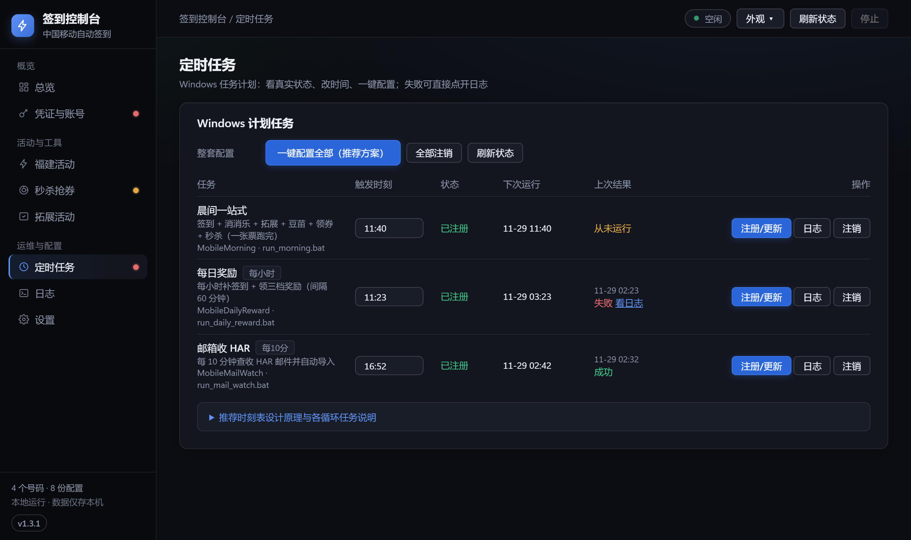
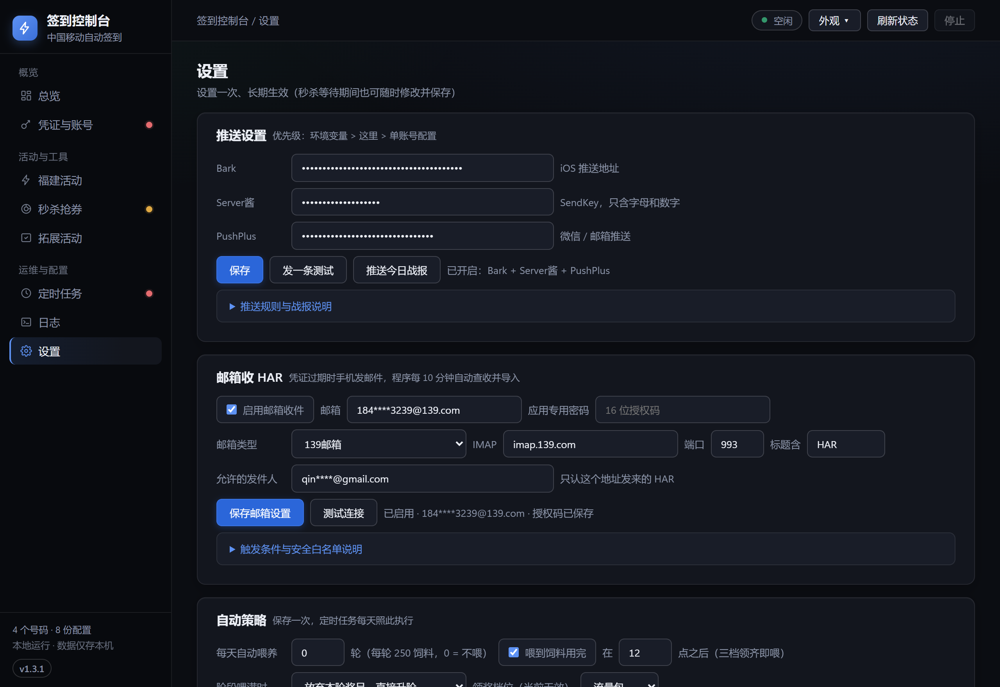

# 中国移动自动领福利助手（福建版） · cmcc-auto-signin

> 全国签到秒杀通用 + 福建活动深度全覆盖：每日签到、养成喂养、消消乐、寻宝抽奖、手气红包与 12:00 秒杀全自动托管。
> 开箱即用桌面控制台 · 多账号并发 · 计划任务 · 邮箱自动收 HAR · 异常合并推送。

[](https://www.python.org/)
[](LICENSE)
[]()

---

**目录**

- 日常用：[功能一览](#功能一览) · [快速开始](#快速开始) · [图形控制台](#图形控制台) · [定时任务](#定时任务) · [停止与卸载](#停止与卸载)
- 活动与玩法：[秒杀抢券](#秒杀抢券每天-1200-抢-1-元话费券) · [功能详解](#功能详解)
- 运维与排障：[Token 获取与刷新](#token-获取与刷新) · [设置与推送](#设置与推送) · [安全与性质说明](#安全与性质说明) · [已知限制](#已知限制)
- 开发与参考：[目录结构](#目录结构) · [常用参数](#常用参数) · [数据与接口文档](#数据与接口文档) · [开发与测试](#开发与测试)

---

## 功能一览

| 平台 | 域名 | 覆盖范围 | 凭证格式 | 实测寿命 |
|---|---|---|---|---|
| **qwhdhub** | `wx.10086.cn` | 全国签到、月签、群签、任务、秒杀 | `app_token` = `JSESSIONID=…; UID=…; ticketID=…` | 随机（10 分钟 ~ 11 小时不等，分钟级实测） |
| **BASS** | `wap.fj.10086.cn` | 福建养成游戏、流量银行、消消乐、优惠抽奖 | `Bearer token` = 36 位 UUID | **≥20 小时**（实测仍存活） |

**已覆盖的活动**

| 活动 | 说明 | 每日收益 |
|---|---|---|
| 全国签到 | qwhdhub 每日 / 每月 / 群签、任务、秒杀 | 流量 + 话费券 |
| 养成游戏签到 | BASS 连续签到，06:00 开放 | 600g → 900g → 1200g 累进 |
| 每日奖励三档 | 阶段一 / 二 / 三，各间隔 60 分钟 | 750 饲料/天 |
| 流量银行 | 浏览类任务 + 点数兑换 | 实测 352MB → 1.5GB |
| 福袋 | 累计喂食达到门槛触发（实测 300 → 500 → 800 递增） | 随机 |
| 优惠抽奖 | 转盘，刷任务换次数 | 流量券 / 话费券 |
| 一起消消乐 | 每次读取真实关卡再上报；自动做金币任务换体力 | 每天约 5 点体力 + 金币兑换 |
| 环闽寻宝记 | 投骰子走棋盘 + 藏宝阁开箱 + 多号互助力换骰子 | 流量包 / 话费券 |
| 拓展活动三合一 | 周六游戏中心 / 追剧领福利 / 全民掼蛋挑战赛 | 游戏币抽奖 / 流量券 |
| 手气红包拆包 | `cmcc_redpacket.py`：查分享码 + 小程序渠道多号互拆 | 流量日包（需微信抓一次小程序包） |
| **AI豆苗养成记** | `cmcc_doumi.py`：移动爱购签到 + 浏览/分享任务 + 逐条领取阳光值；付费/真实操作类自动跳过 | 阳光值（攒满兑视频会员/话费券/流量券） |
| 领券中心 | `cmcc_voucher.py`：按券的开放时间领未领的免费券（话费券、流量券、活动券），重复领自动跳过 | 话费券 / 流量券（需先导入新鲜 HAR） |

> 日常只需双击 `签到领福利.exe`，其余章节用于排障与进阶配置。

---

## 快速开始

> **开箱即用（推荐）**：普通用户可直接前往仓库右侧 **Releases** 下载最新的 `cmcc-auto-signin-v*-win64.zip`，解压后双击 `签到领福利.exe` 即可使用（无需安装 Python；仅注册 Windows 计划任务时需安装 Python 3.9+）。

> **运行环境说明**：双击 `签到领福利.exe` 在界面里点按钮时，任务脚本由 exe 自带运行时解释执行（`--run-script`），**不需要本机安装 Python**，只需确保 exe 与 `cmcc_*.py`、`static/` 在同一目录。但如果要使用 **Windows 计划任务**（`run_*.bat`）或双击 `run_gui.bat` 在浏览器运行，电脑上仍需安装 Python 3.9+ 与 `requests` 等依赖。

### 首次使用（图形界面，无需命令行）

1. **新建账号**：进入「凭证与账号」→ **新建账号**，选择平台并填写手机号（文件名会自动使用尾号）。
2. **手机抓包**：用手机抓包导出 HAR 并微信发送到电脑——页面内「第一次用？」提供了**分步抓包引导**。
3. **扫描并导入**：进入「凭证与账号」→ **扫描并导入**，工具会同时扫描项目目录 / 下载目录 / 微信接收目录，报告中会写明「✓ 实测登录成功」；福建活动配置不存在时会**自动新建**。
4. **注册计划任务**：进入「定时任务」→ **一键配置全部（推荐方案）**，一次性注册 3 个计划任务。
5. **查看待办**：回到「总览」页查看**「现在需要你做什么」**，票据快到期、当天未签到、下一次自动任务都会在这里提示。

### 从源码运行或使用计划任务

1. 安装 Python 3.9+（64 位），安装时勾选 `Add Python to PATH`。
2. 在项目目录地址栏输入 `cmd`，执行：
   ```bash
   pip install -r requirements.txt
   ```
3. 双击 `签到领福利.exe`（或双击 `run_gui.bat` 在浏览器中打开）。

命令行等价运行：

```bash
python run_all.py --luck       # 签到领福利：优惠专区刷任务 + 把转盘次数抽完
python run_all.py --platform doumi   # AI豆苗养成记：单独跑（或加 --doumi 跟签到一起跑）
python cmcc_doumi.py --config configs\3239.json --dry-run   # 只查阳光值和待做任务
```

> **AI豆苗养成记**与全国签到共用 `configs/*.json` 的 `app_token`（当 ticket 用），无需单独配置。
> 任务上报有频率限制，脚本逐条间隔 1~2 秒；付费订购/关注/助力/消费类任务自动跳过。
> 任务完成后阳光值先进「待领列表」，脚本会逐条领取（实测 40 → 90）。

### 手动配置凭证（命令行方式）

Windows 的 `cmd` 中没有 `cp`，请使用 `copy`：

```bat
copy config.example.json    configs\3239.json     :: qwhdhub（全国签到）
copy config_fj.example.json configs_fj\fj1.json   :: BASS（福建活动）
```

填好后先做一次只读检查，确认凭证有效（看到 `2/2 成功` 即正常）：

```bash
python run_all.py --dry-run
```

> 抓包与免抓包获取方式见 [Token 获取与刷新](#token-获取与刷新)。控制台「凭证与账号 → 导入抓包文件」支持从同一份 HAR 同时更新 qwhdhub 与 BASS 凭证并自动按手机号归位；手机号和失败推送（Bark / Server酱 / PushPlus）也可直接在界面中修改。

---

## 图形控制台

### 界面预览

| 控制台总览（双平台隔离卡片 / 待办条 / 到账台账） | 福建活动（分类子标签页 / 每日三档 / 转盘与寻宝） |
|:---:|:---:|
|  |  |
| **定时任务运维（真实状态 / 3 个计划任务）** | **全局运维配置（自动策略 / 推送通道 / 邮箱 HAR）** |
|  |  |

### 页面与功能

| 页面 / 组件 | 内容与特性 |
|---|---|
| **顶栏外观** | 支持**深色 / 浅色**主题切换；支持 **80% ~ 160% 界面缩放**（基于根节点 `rem` 响应式缩放，高分屏不发虚、布局不截断） |
| **总览** | **「现在需要你做什么」待办条**；**到账台账**（今天/本月到手流量、可用话费券，逐条记录时间+来源+兑换链接；需充值才生效的券不列入）；本月流量/任务数/凭证可用数；每号一张卡片（**双平台数据严格物理隔离** + 数据截至时间 + 近 7 天柱状图）；「签到领福利」会执行签到、领取可领饲料并使用已有转盘次数；也可单平台运行或只读检查 |
| **凭证与账号** | ① **账号管理**：新建账号、改手机号、配置单账号失败推送（Bark / Server酱 / PushPlus）<br>② **导入抓包文件**：支持拖拽与智能多目录扫描，一份 HAR 同时更新双平台凭证，内置分步抓包引导 |
| **福建活动** | 顶置**分类子标签页**（全部 / 每日与奖励 / 手动执行 / 抽奖与寻宝 / 流量银行），记忆上次停留状态；优惠专区抽奖；手动执行（领奖/骰子/喂养/只读）；**每日奖励 & 福袋**面板；**全勤满签大奖**；**流量银行任务周期**面板；**环闽寻宝记**面板（投骰子、开藏宝阁）；执行结果保留在结构化容器中 |
| **消消乐** | 星级/局数/间隔与「金币任务换体力」开关（在设置页修改，此处只读展示）；关卡自动读取；只读查次数 |
| **秒杀抢券** | 每天 12:00 抢 1 元话费券；展示各号会话是否备好、**票据已用多少分钟**；过场次时间会明确提示 |
| **拓展活动** | 周六游戏中心 / 追剧领福利 / 玩游戏抽话费，按各自窗口自动判定，支持只查状态与一键做任务 |
| **定时任务** | 真实状态（已注册/下次/上次结果）、改时间、一键配置全部；**每行可直接点开该任务的日志弹窗** |
| **日志** | 本控制台发起的运行，实时彩色输出，支持仅看错误与快捷过滤 |
| **设置** | **设置一次、长期生效**：推送通道（Bark / Server酱 / PushPlus，可发测试）、**邮箱收 HAR**（QQ / 139 / 163 IMAP 授权码；票失效且当天任务未完成时每 10 分钟自动查收并导入）、**自动策略**（喂养轮数与时段、阶段满处理、领奖档位、转盘/寻宝/券来世界联动、消消乐参数、秒杀时刻）。**含表单未保存脏状态提醒（Dirty Badge）**，未保存时红点提示 |

**界面约定**

- **操作反馈**：执行时按钮统一置灰并显示 `忙碌` 状态，顶栏展示实时运行摘要。
- **结构化输出容器**：脚本运行后直接在卡片下方展开输出框，带状态徽章（执行中 / 执行完成 / 含异常）、执行耗时与时间戳，支持一键复制整段日志。
- **容错与终止**：点击**「停止」**会安全终止整棵子进程树并跳过剩余未执行步骤。

统计数据写入 `gui_data/`，运行越久记录越完整。

### 打包 exe

```bat
双击 build_exe.bat          # 首次约 2~5 分钟
dist\签到领福利.exe → 复制到项目根目录
```

打包要求：64 位 Python + `pywebview` + `pyinstaller`。常见问题排查：

- `.bat` 换行必须是 CRLF（若被保存为 LF 会解析错乱）。
- 依赖源建议使用默认 PyPI（部分镜像源曾缺 `pywebview`）。
- `static/` 目录必须完整在位：前端采用零构建原生 ES Modules + 事件委托 + 默认转义模板架构（`index.html`、`app.css`、`app.js` 及 `js/core.js`、`js/dash.js`、`js/activities.js`、`js/ops.js`、`js/runner.js`、`js/logs.js`、`js/update.js`），由 `签到领福利.spec` 的 `datas` 统一打包进 exe。
- 打包配置以 **spec 为唯一来源**：`build_exe.bat` 直接构建 spec；若改回命令行参数构建，PyInstaller 会重新生成 spec 并覆盖手工维护的 `datas`/图标配置。
- 成功标志为日志末尾出现 `Build complete!`，生成约 24MB 的 `dist\签到领福利.exe`。

窗口无法拉起时程序会自动回退到浏览器模式，启动日志记录在 `gui_data/startup.log`。

> **桌面版不依赖系统 Python**：在界面点击按钮时，exe 通过内置解释器以 `签到领福利.exe --run-script cmcc_sign.py --config ...` 执行脚本；源码运行则走 `python cmcc_sign.py ...`，两条路径均由 `common.child_cmd` 调度。（仅 Windows 计划任务通过 `run_*.bat` 调用时，仍需要系统 `pythonw.exe`。）

---

## 定时任务

推荐注册以下三个 Windows 计划任务（已精简，原来的 8 个合并/删除）：

| 任务 | 时间 | 脚本 | 作用 |
|---|---|---|---|
| `MobileMorning` | 每天 **11:40** | `run_morning.bat` | `run_all.py --xxl --games --doumi --voucher --seckill --seckill-at 11:59:50`，一次跑完 qwhdhub + BASS + 签到 + 消消乐 + 拓展活动 + AI豆苗 + 领券 + 秒杀。秒杀脚本内部等到 11:59:50 抢 1 元话费券，全部共用一张新鲜票 |
| `MobileDailyReward` | 每天 **00:00 起每小时**（长期重复） | `run_daily_reward.bat` | `run_all.py --daily-only`，补签到 + 领每日奖励三档 + 触发自动策略（喂养/转盘/寻宝/券来世界） |
| `MobileMailWatch` | 每天 **00:00 起每 10 分钟**（长期重复） | `run_mail_watch.bat` | 凭证失效且当日未完成时查收 HAR 邮件并自动导入与补跑 |

> **为什么精简**：`MobileTokenLifeProbe`（每 2 分钟）和 `MobileJwtKeepAlive`（每 90 分钟）只是探测票据状态——app_token 实测无法续命，探出来过期也没有动作，纯属调试残留；`MobileSessionRefresh`/`MobileSignIn`/`MobileSeckill`/`MobileGames`/`MobileVoucher` 原本拆成 5 个任务，但一张票能覆盖 11:40→12:00 的全部流程，秒杀脚本自身会等到点，合并成一个 `MobileMorning` 即可。**DailyReward 必须保留**：BASS 三档奖励间隔 60 分钟，单次只能领一档，且 BASS 票据按天有效不存在过期问题。

> **每天只需抓一次包**：qwhdhub 的 `app_token` 寿命为服务端单次签发的随机属性（实测 10 分钟 ~ 11 小时不等）。**11:30~11:40 抓包 → 立即发到监控邮箱**，`MobileMailWatch` 每 10 分钟扫描并自动导入；`MobileMorning` 11:40 启动，用同一张票跑完签到 → 消消乐 → 拓展 → 豆苗 → 领券 → 秒杀。票据寿命从在 App 内抓包那一刻起算，久放不发等于白抓。若中途过期导致部分失败，你补一张新 HAR 后 MailWatch 会自动补跑一次。BASS（福建）使用 Bearer token，按天有效，无需每天抓包。

> **无黑窗口运行**：所有计划任务均通过 `pythonw.exe` + `run_hidden.py` 启动 bat，子进程带 `CREATE_NO_WINDOW`，桌面不会弹出控制台窗口。

### 为什么需要 `MobileDailyReward`（每小时任务）

1. 每日奖励三档（150 / 250 / 350 饲料）之间必须间隔 60 分钟，单次运行只能领一档，每小时轮询才能领齐全天 750 饲料（本地记录已领满时 1 秒退出）。
2. BASS 签到 **06:00 才开放**（`signBeginHour=6`），奖励按连续签到累进（第 1 天 600g → 第 2 天 900g → 第 3 天 1200g），**断签一天即重置回 600g**。起始时间定在 `06:03` 而非 `06:00`，是为了避开整点数据刷新边界。

### 为什么没有会话保活任务

`appTokenLogin` 请求体中同时包含 `jwtToken` 与 `token`。**2026-11-20 对照实验**已证伪「`jwtToken` 可免票据长期续期」的假设：

| 组合 | 结果 |
|---|---|
| `jwtToken` + `token=""` | FAILED　APP登录状态已过期 |
| `jwtToken` + 伪造的 token | FAILED　APP登录状态已过期 |
| `jwtToken` + 真实 `app_token` | **SUCCESS** |

服务端真正校验的是 **`token`（App 票据）**，`jwtToken` 单独使用无法通过校验——票据无法续命，探测状态也没有意义（探到过期也没动作）。所以不再注册 `MobileJwtKeepAlive` 这类保活任务；过期检测交给 `MobileMailWatch` + 失败推送，补票由收到新 HAR 后自动补跑完成。下表记录当年的对照实验结论：

### 命令行管理与注册

```bat
python cmcc_fj.py --config configs_fj/fj1.json --daily-only   # 单号每日奖励
python run_all.py --daily-only                                 # 所有 BASS 账号每日奖励
python run_all.py --keepalive                                  # 只试登录，不签到
```

建议直接在控制台「定时任务」页点击「一键配置全部」，等价 PowerShell 注册命令如下：

```powershell
# 1. 晨间一站式（签到+消消乐+拓展+豆苗+领券+秒杀，一张票跑完）
$a = New-ScheduledTaskAction -Execute "pythonw.exe" -Argument '"<项目目录>\run_hidden.py" "<项目目录>\run_morning.bat"' -WorkingDirectory "<项目目录>"
$t = New-ScheduledTaskTrigger -Daily -At 11:40
Register-ScheduledTask -TaskName "MobileMorning" -Action $a -Trigger $t -Force

# 2. 长期重复任务（PowerShell 5.1 需在 New-ScheduledTaskTrigger 直接传 Repetition 参数）
$start = (Get-Date).AddMinutes(2).ToString("HH:mm")
$a2 = New-ScheduledTaskAction -Execute "pythonw.exe" -Argument '"<项目目录>\run_hidden.py" "<项目目录>\run_daily_reward.bat"' -WorkingDirectory "<项目目录>"
$t2 = New-ScheduledTaskTrigger -Once -At $start -RepetitionInterval (New-TimeSpan -Hours 1) -RepetitionDuration (New-TimeSpan -Days 3650)
Register-ScheduledTask -TaskName "MobileDailyReward" -Action $a2 -Trigger $t2 -Force
```

> 重复型任务（`MobileDailyReward`、`MobileMailWatch`）均使用未来起点 + `-RepetitionDuration (New-TimeSpan -Days 3650)`，避免过去时刻被推迟到次日或隔天停摆。

---

## 停止与卸载

本项目没有后台常驻守护进程（daemon），实时任务由图形控制台或命令行触发，后台自动化全部依赖上面 3 个 Windows 计划任务。

### 1. 停止正在运行的任务

- **图形控制台**：直接点击界面中的 **「停止」** 按钮，会安全终止整棵子进程树并跳过剩余未执行步骤。
- **命令行**：在对应终端窗口按 `Ctrl + C` 即可中断。

### 2. 暂停或彻底关闭后台自动运行

你可以通过控制台「定时任务」页逐个禁用/删除任务，也可以在管理员 PowerShell 中批量操作：

**仅暂停（禁用计划任务，后续可随时恢复）：**

```powershell
$tasks = @(
  "MobileMorning",
  "MobileDailyReward",
  "MobileMailWatch"
)
$tasks | ForEach-Object { Disable-ScheduledTask -TaskName $_ -ErrorAction SilentlyContinue }
```

**彻底清理（注销并删除全部计划任务）：**

```powershell
$tasks = @(
  "MobileMorning",
  "MobileDailyReward",
  "MobileMailWatch"
)
$tasks | ForEach-Object { Unregister-ScheduledTask -TaskName $_ -Confirm:$false -ErrorAction SilentlyContinue }
```

### 3. 卸载软件

完成上述「注销全部计划任务」后，直接删除整个项目目录即可完成卸载（如需保留账号配置或历史台账，请提前备份 `configs/`、`configs_fj/` 与 `gui_data/`）。

---

## 秒杀抢券（每天 12:00 抢 1 元话费券）

签到页面里的「每周秒杀」**每天 12:00 ~ 13:00 开抢**，奖品为 1 元话费券，每个账号每周限抢 1 次，领取资格每周重置。实现见 `cmcc_seckill.py`，接口细节见 [docs/seckill.md](docs/seckill.md)。

```bash
python cmcc_seckill.py --config configs/3239.json --dry-run   # 只查场次与资格
python cmcc_seckill.py --config configs/3239.json --once      # 立即打一次看响应
python cmcc_seckill.py --config configs/3239.json             # 等下一场自动抢
```

**关键机制：会话 Cookie 可脱离 `app_token` 复用——但建立后 2 小时硬过期。**
实测注入 `QWHD_SESSION_TOKEN` cookie 即可调用全部秒杀接口（含 `redeem`）：

- 每次 qwhdhub 签到成功后自动保存会话到 `gui_data/seckill_session_<尾号>.json`。
- 秒杀脚本优先读取已保存会话（探活失败才回落到 `app_token` 重新登录）。
- 会话建立后 2 小时硬过期（两次独立探测均在 120 分钟准时返回 `GOTO_LOGIN`），请求、带 jwt 或重访 SSO 链接均无法续期：

| 签到时刻 | 会话失效 | 覆盖 12:00？ |
|---|---|---|
| 08:30 | 10:30 | ❌ |
| **11:40** | **13:40** | ✅ |

因此 `MobileMorning` 定在 **11:40** 签到建会话，2 小时内足以覆盖 12:00 秒杀；该步骤仍需有效 `app_token`。

**并发与重试细节**

- 服务器时间比本机快约 1 秒，脚本通过 `markSeckill/sysTime` 校准后**提前 0.4 秒**出手；被拒后每 2 秒核对一次库存（实测 `leaveStock=0` 仍可能中奖，不会因库存显示为 0 而提前放弃），直至拿到终态码或达上限才停手。
- 多账号**并发**等待同一时刻一起出手；`run_all.py` 会按 `--seckill-at` 距当前时间动态计算超时上限。
- 启动时拿不到会话会每 15 秒重试一次直到 `11:59:50 + 60 秒`，且**每轮重读配置文件**，等待期间导入新 HAR 可自动生效，无需重启。

> 限制：已实测 12:00 开抢中奖（如 2 元话费券），但每天仅 12:00 ~ 13:00 一场且高峰限流严重，库存通常只有 1 份；资格要求当日已签到（脚本会自动补签）。

---

## 功能详解

### 养成游戏签到

`GET /sign/getSignInfo` 返回 `signBeginHour`（开放小时）与 `signDateList`（未来累进奖励），`GET /sign/doSign` 领取。断签会让 `cycleDay` 重置回 1，签到由每小时任务兜底。

### 每日奖励（三档）

`GET /index/getDailyReceiveTask` 返回三档，**共 750 饲料/天**：

| 档位 | 饲料 | 间隔 |
|---|---|---|
| 阶段一 | 150 | — |
| 阶段二 | 250 | 60 分钟 |
| 阶段三 | **350** | 60 分钟 |

判断依据为 `currentTask=true`（`taskStatus` 仅有 `RECEIVED` / `UN_DO`）。未到间隔返回 `1504`，控制台直接显示服务端返回的 `limitReceiveTime` 与 `surplusTime`。常规运行与每小时任务也会顺带领取已开放的「投喂累计奖励」（`getNextReceiveTask`）：`1503` 当日已领、`1600` 前置任务未完成（当天还没喂）都视为「无待领」，其它失败会打印 code/msg。

### 券来世界（`--coupon-world`）

养成任务 **id=24「APP首页访问活动」**，落地页为 `https://wap.fj.10086.cn/bass-feedPrizeH5/?ch=jituan_02`，每天一次，奖励 **500 饲料**。脚本会先 `GET` 一次券来世界页面，再调用 `POST /bass-cultivateGameServer/task/doTask/24`；在每小时轮询短路判断前会先检查该任务是否完成，避免被跳过。

### 福袋与喂养策略

- **福袋**：`GET /luckyBag/nearTrigger` → `{nextTriggerCount, currentFeedCount, needMoreFeeds}`，累计喂食达到门槛触发一次，门槛逐级递增（实测 300 → 500 → 800）。福袋开出的随机奖励目前接口不回传，脚本无法识别记账，需在 App 内查看。
- **喂养**：`GET /stage/batchFeed` 每次消耗 250 饲料、计 5 次喂食、阶段进度 +250；已接入 `doMeet` 轮次解锁（老号返回 `1606 非新人` 自动跳过）。

在控制台「设置 → 自动策略」保存后（存盘于 `gui_data/policy.json`），由 `MobileDailyReward` 自动读取执行：

| 字段 | 含义 |
|---|---|
| `feed` / `feed_hour` | 每天在指定时间**之后**、且**该账号**三档饲料（150/250/350）全部领齐后一次性喂几轮（每轮 250 饲料，0 = 不喂）。**按账号判断**：某个号票失效或三档没领完，不影响其它号喂养；每号每天只喂一次（子进程确认真喂了才记，状态在 `gui_data/feed_state.json`） |
| `feed_all` | `true` = **喂到饲料用完**（按 `饲料 // 250` 自动算轮数，不足 250 自动停手），默认 `false` |
| `on_stage_full` | `stop` 停手 / `claim` 领本阶奖品后继续喂（`--auto-claim`）/ `continue` 放弃奖品直接升阶（`--continue-stage`，互斥） |
| `prize` | 领奖档位（`fee` / `flow` / `discount`），当前服务端均为权重随机开奖；六阶「换其他档位」接口暂未实现 |
| `tasks` / `fb_tasks` | 空报浏览类任务开关，默认 `false` |
| `luck` / `luck_tasks` | 是否自动抽完「优惠专区 · 天天大转盘」及是否先做加次数任务，默认均 `true`（「请好友帮忙」自己上报不加次数，默认跳过） |
| `xunbao` / `xunbao_tasks` | 是否自动投完「环闽寻宝记」骰子并开宝箱，及是否上报「参与天天大转盘」换骰子（好友助力永不代报），默认均 `true` |
| `coupon_world` | 是否每天做一次「券来世界」访问任务（500 饲料），默认 `true` |
| `sign_claim` | 全国签到后自动领取已达成的连签/累计签到奖励（如「5签5GB流量券」，不是空报），默认 `true`；保活任务不领 |

手动单号喂到用完：`python cmcc_fj.py --config configs_fj/fj1.json --feed-all`（与 `--feed N` 互斥，可加 `--dry-run` 预览）。

### 到账台账（`gui_data/awards.json`）

脚本在**领到奖品那一刻**通过 `common.record_award()` 写入流水（同号同奖品同分钟内自动去重），由 `dashboard._awards_view()` 汇总：

| 字段 | 说明 |
|---|---|
| `at` / `account` / `source` | 到手时间、号码、来源（天天大转盘 / 养成领奖 / 每日签到） |
| `name` / `kind` | 奖品名；`flow` 流量 / `fee` 话费券 / `coupon` 折扣券 |
| `size_mb` | 流量折算 MB（1GB=1024MB），话费券为 0 |
| `need_recharge` | `true` = 需充值/满减才生效（如「充值9.9折券」），**界面不列入台账**，仅单独计数 |
| `url` | 兑换/领取链接 |

### 流量银行

`POST /flowBank/doTask`，body `{appId, timestamp, taskId}`。`completeStatus`：0=未做（需请求两次 0→2→1）、2=进行中（一次）、1=已完成。内置 3.5~5.5 秒间隔以规避 `1006 操作太快` 频控。`taskCycle` 为 **1=每月一次，2=每周一次**，本地状态记在 `gui_data/flowbank_state.json`。

### 消消乐

逆向自 `assets/main/index.js`：`playEnd` 的 `gameLevel` / `score` 为本地 AES-CBC 加密（key=`8cc70bf2a955c6bf`、iv=`1692bc56e8b783f4`、ZeroPadding、前拼 9 位随机字母），`score` 为星级（0~3）。关卡每次现读 `indexInfo.gameLevel`（`--level` 仅作兜底）。

开启 `--tasks` 后：`taskType=2`（浏览/访问）先打开页面再 `doTask`，`taskType=3`（分享）直接 `doTask`，各 +200 金币；`taskType=1`（好友助力）支持自有账号互调 `help/{码}`（每对号每月限一次，状态记在 `gui_data/xxl_assist_state.json`）。拿到金币后自动将 `propType=12`（道具爱心）按 **200 金币/点**兑换体力（每日最多 20 次）。

三个限制：
1. 中奖由服务端抽奖池决定，与关卡/星级无关；「谢谢参与」会被过滤不记入台账。
2. 每天基础 5 点体力（`dayLimit=100` 为假上限），可用金币兑换补充。
3. 体力不足时部分接口返回 `-100`，不代表 token 失效；脚本遇「体力」关键词或关卡未推进会提前停止。

### 优惠专区抽奖与手气红包

三个接口均为 GET，只需 `appId` + `timestamp`，共用 `configs_fj/*.json` 的 `bearer_token`（无需额外抓包）：

```
GET /bass-preferentialAreaServer/luck/index              → 剩余次数 + taskList
GET /bass-preferentialAreaServer/luck/doTask/{type}/{id} → 完成任务
GET /bass-preferentialAreaServer/luck/join               → 抽奖
```

支持「中国移动APP中参与 / 浏览调研页面 / 逛移动爱购商城」等加次数任务，已完成（`complete:true`）会自动跳过；上报后次数没涨会提示「上报 N 个任务但抽奖次数未增加」。「请好友帮忙」必须由好友在微信小程序里真实助力才加次数，自己上报只回 `0000` 不涨次数，**默认跳过**（`--report-assist` 可强制上报）。`luck/index` 在 bearer 失效后仍会返回数据，所以脚本以 `qrySubscription` 的 `401` 判定凭证失效，只读检查也能发现。

**手气红包拆包（`cmcc_redpacket.py`）**：转盘抽中手气红包只是待分享状态，需分享给好友当日拆包双方才各得同等面值（每号每期仅限帮拆 1 次）。

> **前提**：每个「拆包号」需先用微信打开一次活动小程序并抓一次包（ProxyPin 抓 `wxAppletService/wx/code2session` 即可），拆包接口仅认**小程序渠道**签发的 bass token（APP token 会返回 `BASS-0001`）。分享码 `encodeJoinId` 每次现查现用，脚本默认 dry-run，实际拆包需加 `--go`（自动跳过自己的包）。接口细节见 [docs/bass.md](docs/bass.md#手气红包拆包2026-11-26-抓包实测脚本-cmcc_redpacketpy)。

### 环闽寻宝记（`cmcc_xunbao.py`）

活动页 `https://wap.fj.10086.cn/bass-activityH5/pages/nationalDay2026/index`，后端 `bass-commonAreaServer/H5Api/hmxb/*`（POST JSON，body 为 `appId` + `timestamp`）：

```
activity/status  activity/init   dice/balance   dice/roll
task/list        task/report     treasure/open  treasure/poolPreview
prize/list       prize/claim     assist/create  assist/detail  assist/do
```

注意事项：
1. **UA 必须带 App 标记** `leadeon/12.5.7/CMCCIT`（仅写 `leadeon/12` 会回 `2004 请前往中国移动App参与活动`）。
2. 骰子当日清零；「打开消息提醒」与空报好友助力一律不代报（`SKIP_TASKS`）；支持 `--mutual-assist` 多号真实互点助力（每号每天限助他人 1 次，且同一对号码每月限互相助力 1 次；状态按「月 + 号对」记在 `gui_data/xunbao_assist_state.json`，本月已互助的号对直接跳过，服务端回 `-100 当月不可为同一人助力` 也记为已做）；任一接口回 `401` 即判该号凭证失效并计入失败与提醒；「参与一起消消乐 / 参与天天大转盘」两个加骰子任务**按账号**判断，只有该号今天真玩成过消消乐（`gui_data/xxl_daily_state.json`）、本轮真抽过转盘才上报；「15元购10GB」等付费券包按 `common.PAY_WORDS` 归类为有门槛，不计入已得流量。

```bash
python cmcc_xunbao.py --dry-run          # 只查进度/骰子/任务/奖品
python cmcc_xunbao.py                    # 投掉现有骰子
python cmcc_xunbao.py --key fj2 --tasks  # 顺手上报大转盘任务换骰子
python cmcc_xunbao.py --mutual-assist    # 多号真实互点助力换骰子
python cmcc_xunbao.py --key fj1 --invite # 生成好友助力链接
```

---

## Token 获取与刷新

凭证等同账号钥匙，仅在个人电脑操作，切勿外传或上传网盘。

### 刷新 qwhdhub

1. 手机抓包，打开中国移动 App → 我的 → 签到领流量。
2. 搜索 `appTokenLogin`，确认请求体中有 `"token": "JSESSIONID=…"`（若 App 已登录未触发该请求，脚本会自动从 `wx.10086.cn` 请求头 `x-token` 兜底提取，并通过 `/qwhdhub/api/mark/user/info` 的脱敏手机号匹配账号）。
3. 导出 HAR 后通过控制台「凭证与账号 → 导入抓包文件」导入：
   - **导入**：直接选择或拖拽 `.har` 文件。
   - **自动查找**：自动扫描项目目录 / 下载目录 / 微信接收目录，按时间顺序落地并避免旧票据覆盖新票据；并立即执行一次实测登录验证。**导入成功、或 HAR 里一个凭证都没有时自动删除原抓包文件**（含微信接收目录里的只读文件）；找到凭证但实测/写入失败、或文件解析失败时保留以便重试。

> **注意事项**：App 内切换账号会使另一个号的 `app_token` 失效，多号尽量分设备登录。`app_token` 为单次签发随机寿命（10 分钟 ~ 11 小时不等），且 `jwtToken` 单独无法通过登录校验，因此 qwhdhub 仍需定期抓包更新。

### 刷新 BASS

抓包任意 `wap.fj.10086.cn` 请求的 `Authorization: Bearer <36位UUID>`，用 HAR 导入会自动按手机号归入 `configs_fj/fjN.json`。

**免抓包路线**（需手机蜂窝网络，不可用 WiFi）：

```bash
pkg install python && pip install requests
python pull_token_phone.py --save     # Android Termux
```

原理为 `pageInit → getMobile → getSign → getToken → validateToken`（本机号码一键登录），PC 端会返回 `网关未插入手机号`。iPhone 可使用 `pull_token_iphone.js`。该链路换出的是 BASS 平台凭证，不适用于 qwhdhub。

---

## 设置与推送

### 设置页（`gui_data/settings.json` / `gui_data/policy.json` / `gui_data/mail_settings.json`）

- **推送设置**：统一配置 Bark / Server酱 / PushPlus，可发测试消息。
- **邮箱收 HAR**：配置邮箱、IMAP 授权码与允许发件人，每 10 分钟检查一次。仅在「凭证失效且当天任务未完成」时连邮箱；收到 `.har` 附件自动导入并推送结果，且仅在报告确认「实测成功」时自动补跑当天签到。支持 QQ / 139 / 163 邮箱授权码（139 授权码有效期 90 天；**Gmail 已转向 OAuth2，不支持密码方式**）。
- **自动策略**：集中管理喂养、领奖档位、转盘/寻宝/券来世界、消消乐与秒杀参数，修改后即时生效。

### 今日战报与失败推送

- **今日战报**：有真实收获或跑完非只读任务时推送一次汇总（20 小时内不重复），仅显示账号尾号；话费型手气红包、话费加赠券、付费券包及有门槛券不计入到手流量。
- **失败推送去重**：凭证过期类错误合并为一条（12 小时内不重复），其余失败汇总为一条（20 小时内不重复）；批量运行时子脚本通知由 `CMCC_NOTIFY_BATCH=1` 抑制，状态通过 `file_lock` 原子写入 `gui_data/notify_state.json`。
- **安全校验**：自定义推送 URL 强制防 SSRF 校验（拦截内网与回环 IP），并校验 HTTP 状态码与业务返回码。

| 通道 | 填写内容 | 获取方式 |
|---|---|---|
| Bark | 推送地址，如 `https://api.day.app/你的key` | Bark App |
| Server酱 | SendKey（字母数字） | `sct.ftqq.com` |
| PushPlus | 32 位十六进制令牌 | `pushplus.plus`「我的令牌」 |

优先级：**环境变量**（`CMCC_BARK_URL` / `CMCC_SERVERCHAN_SENDKEY` / `CMCC_PUSHPLUS_TOKEN`）> **设置页** > **单账号配置**。

---

## 安全与性质说明

- `configs/`、`configs_fj/` 包含账号凭证，**切勿外传**；控制台仅监听 `127.0.0.1`。
- **不要使用 GitHub Actions 运行签到任务**（避免将个人凭证上传至第三方环境）。
- **空报浏览**（`--tasks` / `--fb-tasks` / 抽奖 `doTask`）属跳过真实浏览的上报行为，默认不勾选，界面带 ⚠ 提示。
- **消消乐**：模拟通关成绩上报，与签到主流程独立。
- **安全警示**：曾逆向过的「省钱宝」外挂申请 `READ_SMS`（可读取银行验证码）且走明文 HTTP，切勿安装。
- 本项目仅供学习交流，使用前请自行确认是否符合运营商服务条款。

---

## 已知限制

- qwhdhub 的 `app_token` 本质为中国移动 App 主站会话 Cookie，寿命随机（10 分钟 ~ 11 小时不等），`jwtToken` 无法单独续期，仍需定期抓包。
- BASS 是目前最稳定的凭证（实测存活 ≥20.6 小时），目前仅适配福建站（`wap.fj.10086.cn`）。
- 打包成 onefile exe 后，所有数据路径统一通过 `common.app_base()` 指向 exe 所在目录（避免写入 `_MEIxxxx` 临时目录导致重启丢失）。
- BASS 签到在凌晨返回 `1502 未到可签到时间` 属正常；每日奖励三档间隔 60 分钟，未启用 `MobileDailyReward` 只能领到第一档；自动喂养需等三档领齐（约 3 小时）后统一执行。
- 消消乐每天约 5 点基础体力，中奖概率低。
- 拓展活动由 `MobileMorning`（11:40）每日运行：周六游戏中心全周可抽（10 币/次，31 天周期清零），追剧领福利仅周日开放抽奖（其余日子攒次数），全民掼蛋挑战赛任务与抽奖均自动完成；遇到「未中奖」会继续抽完剩余次数，同次中多张相同奖品逐张记账。
- 周三充值日（`cmcc_wed.py`）端点来自公开实现，尚未用有效票据实测；邀请助力与真实充值一律不代做。
- 秒杀 12:00 场次限流严重且库存通常只有 1 份，依赖 11:54 建立的新会话与有效 `app_token`。

---

## 目录结构

```
.
├── 签到领福利.exe          桌面版入口（用 build_exe.bat 构建，不入库）
├── run_gui.bat             无 exe 时用浏览器打开控制台（跑 python dashboard.py）
├── run_morning.bat         晨间一站式（11:40：签到+消消乐+拓展+豆苗+领券+秒杀）
├── run_daily_reward.bat    定时领每日奖励（每小时，BASS 三档间隔 60 分钟）
├── run_mail_watch.bat      定时查收邮箱 HAR 附件并自动导入（每 10 分钟）
├── run_hidden.py           无窗口启动器（计划任务用它跑 bat，不再闪黑窗口）
├── common.py               共用基础设施：原子写、文件锁、通知、会话、接口调用、日志轮转
├── disk_imports.py         冻结环境下优先从磁盘加载项目 .py 模块
├── run_all.py              批量调度（多账号并发、失败推送、日志轮转）
├── cmcc_sign.py            qwhdhub 签到（全国）
├── cmcc_extra.py           qwhdhub 拓展活动模块
├── cmcc_fj.py              BASS 签到 + 喂养 + 每日奖励 + 流量银行 + 福袋
├── cmcc_xiaoxiaole.py      消消乐
├── cmcc_luck.py            优惠专区转盘抽奖（加次数任务 + 抽完次数）
├── cmcc_redpacket.py       优惠专区手气红包查分享码与小程序渠道拆包
├── cmcc_xunbao.py          环闽寻宝记（投骰子、开宝箱、奖品领取）
├── cmcc_seckill.py         签到有礼每周秒杀（12:00 抢话费券）
├── cmcc_wed.py             周三充值日（拼图任务、抽奖、集齐领券）
├── har_import.py           从 HAR 提取 qwhdhub + BASS 凭证并写配置
├── mail_watch.py           邮箱收 HAR 附件并自动导入与补跑
├── probe_token_life.py     app_token 寿命精确探测（分钟级）
├── dashboard.py            图形控制台后端（HTTP API + 任务调度）
├── static/                 控制台前端静态资源（打包时由 spec 的 datas 整体带上）
│   ├── index.html          主页面（深色/浅色、外观设置弹层、子标签页、表单脏状态提示）
│   ├── app.css             样式与主题变量（rem 缩放、骨架屏、状态徽章、响应式输入网格）
│   ├── app.js              入口与路由、分片脏渲染、统一轮询与集中式事件委托
│   └── js/                 原生 ES Modules 业务模块
│       ├── core.js         共享状态、SafeHtml 默认转义模板、弹层/气泡、缩放与深浅色主题
│       ├── dash.js         总览面板、双平台数据独立卡片、到账台账与效率看板
│       ├── activities.js   活动子标签页切换、账号弹窗、大转盘/寻宝/流量银行/秒杀面板
│       ├── ops.js          计划任务列表与弹窗日志、配置脏状态追踪、HAR 导入
│       ├── runner.js       各活动手动执行入口与结构化输出捕获（CAP）
│       ├── logs.js         实时日志过滤、复制与迷你抽屉
│       └── update.js       版本显示与 GitHub Releases 更新检测
├── app_desktop.py          桌面版入口（pywebview 原生窗口 + --run-script 调度）
├── pull_token_phone.py     手机一键登录换 BASS token（免抓包）
├── pull_token_iphone.js    同上，iPhone Scriptable 版
├── probe_fj.py             只读探测 BASS 接口
├── config.example.json     qwhdhub 配置模板
├── config_fj.example.json  BASS 配置模板
├── eslint.config.mjs       前端 ESLint 9 规则（ESM、安全模板与样式约束）
├── package.json            前端 lint:js / test:js 脚本与开发依赖
├── tests/                  单元、回归与前端行为测试（含 tests/frontend/，全部用假响应）
├── docs/                   接口文档（qwhdhub / 秒杀 / 周三充值日 / BASS）
├── configs/                真实 qwhdhub 配置（不入库）
├── configs_fj/             真实 BASS 配置（不入库）
├── gui_data/               运行状态与统计（不入库）
└── logs/                   运行日志（不入库）
```

---

## 常用参数

```bash
python run_all.py --xxl                                         # 全部 + 消消乐
python run_all.py --platform bass --dry-run                     # 仅 BASS 只读检查
python run_all.py --log logs/daily.log                          # 同时写入按天轮转日志
python cmcc_fj.py --config configs_fj/fj1.json --claim          # 领阶段奖励
python cmcc_fj.py --config configs_fj/fj1.json --feed 3         # 喂养 3 次（每次 250 饲料）
python cmcc_fj.py --config configs_fj/fj1.json --fb-tasks       # 流量银行任务（按周期门控）
python cmcc_fj.py --config configs_fj/fj1.json --fb-tasks --fb-all  # 忽略周期强制尝试
python cmcc_luck.py --key fj2 --dry-run                         # 抽奖：只查次数
python cmcc_luck.py --key fj2                                   # 刷任务时默认跳过「请好友帮忙」
python cmcc_redpacket.py --mine --har 我的APP包.har             # 列我抽到的手气红包与实时分享码
python cmcc_redpacket.py --har 拆包号的小程序包.har --go        # 真拆别人的红包（不可逆）
python cmcc_xiaoxiaole.py --config configs_fj/fj1.json --detect-level --times 5
python probe_token_life.py --report                             # 查看 app_token 寿命结论
python probe_token_life.py --once                               # 手动探测一轮
```

### `app_token` 寿命探测示例

手动执行 `python probe_token_life.py --once` 可探测登录状态（探测任务已从定时任务中移除，命令仍可用），签发时刻取自 HAR 中 `appTokenLogin` 时间戳，确认失效后自动停止探测：

```text
--- ...3239（184****3239）
    距签发 30 分钟仍有效；09:05:00 首次失效（采样间隔 2 分钟） → 票据寿命 30~53 分钟
```

---

## 数据与接口文档

### 本地运行数据

| 文件 | 内容 |
|---|---|
| `gui_data/stats.json` | 累计流量/任务数、近 7 天记录、token 状态 |
| `gui_data/daily_state.json` | 每日三档奖励、连续签到状态、福袋进度 |
| `gui_data/flowbank_state.json` | 流量银行任务周期与上次完成时间（显示时优先用只读接口实时回查，查不到会标注记录日期） |
| `gui_data/feed_state.json` | 各账号当天是否已自动喂养 |
| `gui_data/xxl_daily_state.json` | 当天真正玩成过消消乐的账号（寻宝按号上报「参与消消乐」用） |
| `gui_data/xxl_state.json` | 各账号消消乐剩余体力、今日通关、当前关卡与近期明细 |
| `gui_data/luck_state.json` | 抽奖次数与中奖记录 |
| `gui_data/runs.json` | 运行次数、成功率、机器工时 |
| `gui_data/token_life/<尾号>.json` | `app_token` 寿命探测样本与结论 |
| `logs/daily.log` | 定时任务日志（按天轮转，保留 7 天） |

> 统计口径：流量只计入**带 MB/GB 的奖品**（话费券不计入）；喂养单列 `feeds`。

### 接口文档（[docs/](docs/)）

- [docs/qwhdhub.md](docs/qwhdhub.md) —— 全国签到平台端点与凭证获取
- [docs/bass.md](docs/bass.md) —— 福建站养成游戏、流量银行、抽奖、消消乐、手气红包拆包（含 APP / 小程序双 token 分工与实测失败码）
- [docs/seckill.md](docs/seckill.md) —— 每周秒杀接口细节
- [docs/wedrecharge.md](docs/wedrecharge.md) —— 周三充值日（独立活动，含服务器时间戳）

---

## 开发与测试

```bash
pip install -r requirements.txt
python -m unittest discover -s tests -v      # 约 500 个用例，覆盖全部业务、安全与界面
pip install ruff && ruff check .             # Python 代码检查（规则见 pyproject.toml）
npm ci && npm run lint:js && npm run test:js # 前端 ESLint 规则检查 + jsdom 行为测试
python tests/browser_smoke.py                # 可选：真实浏览器冒烟（需 playwright）
```

所有单元测试均使用临时目录与假响应，**不读取 `configs/`、不发起任何真实网络请求**。`tests/_guard.py` 通过审计钩子硬性禁止测试写入真实的 `gui_data/`、`configs/`、`configs_fj/` 与凭证缓存，任何遗漏都会直接报错。仓库配置了仅用于跑测试的 GitHub Actions（`.github/workflows/tests.yml`：单元测试覆盖 Windows + Linux × Python 3.9/3.12，另设 `ruff` 代码检查与 `js-lint` 前端 ESLint + 行为测试 job）。

- `tests/test_regressions.py`：覆盖真实修复过的回归缺陷（保活参数丢失、消消乐退出码、HAR 签发时刻跨号污染、并发写状态冲突、路径穿越与跨站请求、冻结态计划任务解释器、停止按钮终止孙子进程、首屏阻塞、全新安装建号等）。
- `tests/test_ui.py`：守卫前端界面契约（中文标题、待办条、真实任务状态、不暴露命令行参数、消消乐默认不勾、忙时按钮置灰、ES 模块分层与 `data-act` 委托完整性、无内联事件与裸 HTML 拼接、`rem` 缩放与外观弹层契约等）。
- `tests/frontend/ui.test.mjs`：基于 `node:test` + `jsdom` 的前端行为测试（首屏渲染、台账折叠与筛选、子标签切换、确认弹窗与接口请求载荷校验、表单校验与脏状态、日志过滤、忙态置灰、主题缩放与 XSS 转义）。

三个测试文件均支持直接独立运行（如 `python tests/test_smoke.py`）。

---

## 相关项目

- [yupaiLy/cmcc-auto-checkin](https://github.com/yupaiLy/cmcc-auto-checkin) —— 同为中国移动签到自动化的开源项目，按省份分目录组织，本项目 qwhdhub 部分思路与其相近，在此致谢。

## License

MIT
